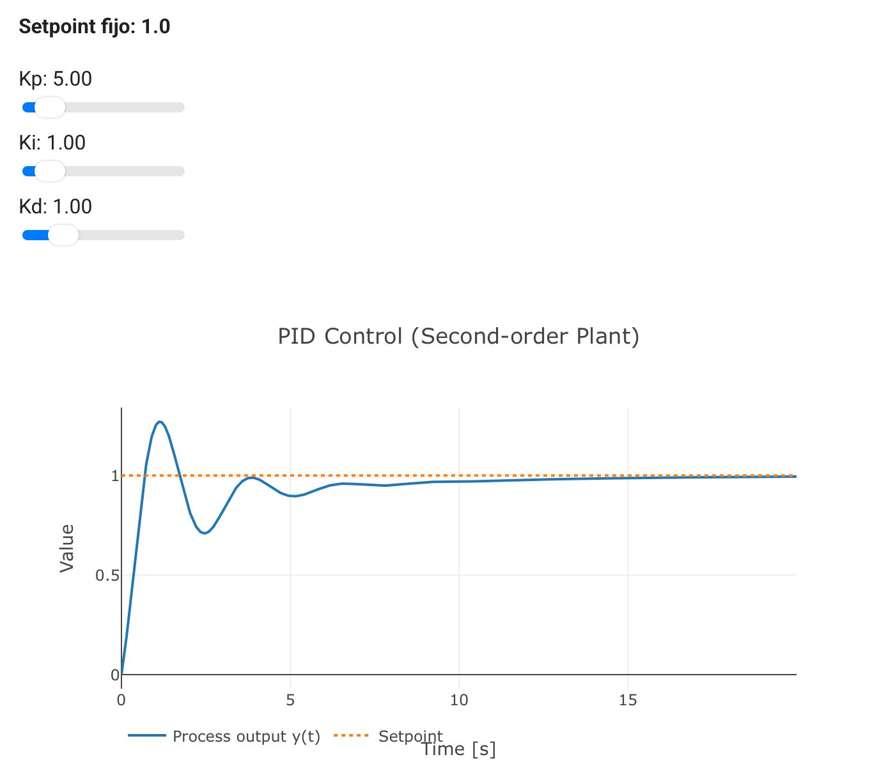
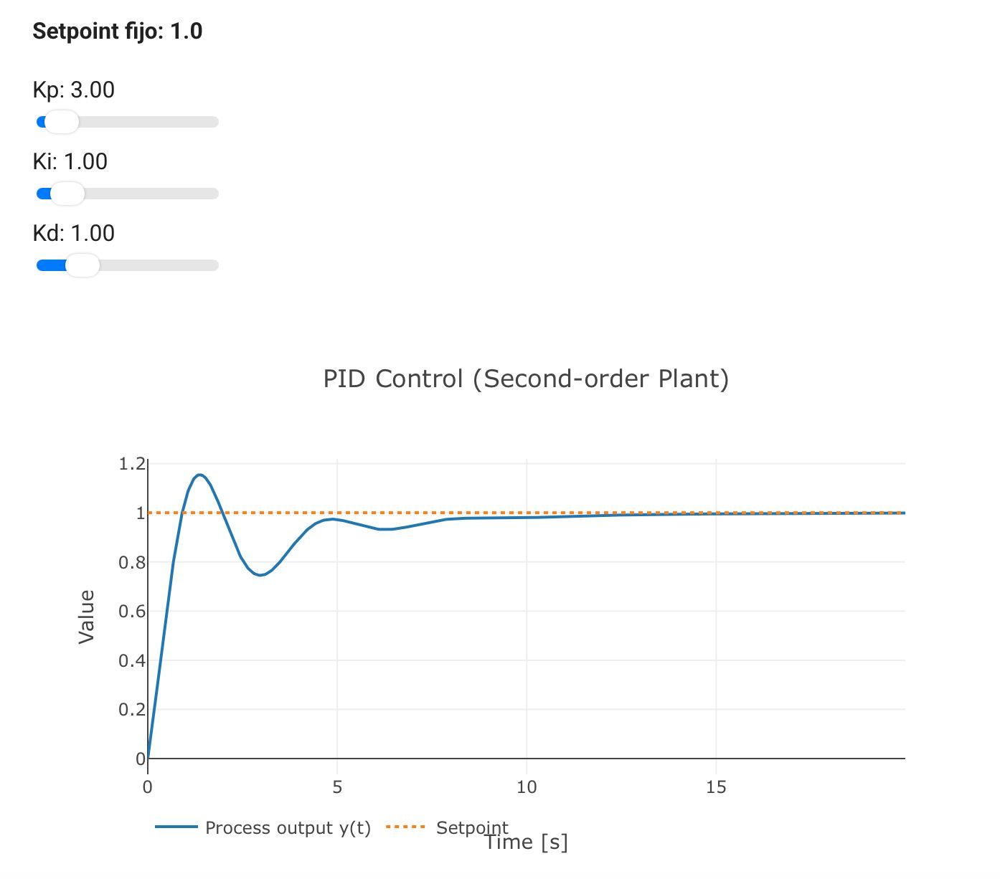

# Práctica: Control PID

## 1. Proposito de la practica

En esta práctica trabajamos con el control PID, un método utilizado en sistemas de control para conseguir que un sistema alcance un valor deseado de manera estable y precisa. Mediante la modificación de las ganancias Kp, Ki y Kd, observamos cómo cambia la respuesta del sistema y cómo se pueden reducir las oscilaciones, el sobreimpulso y el error permanente.

## 2. 

Un sistema de control de lazo cerrado utiliza sensores para medir su salida y compararla con un valor de referencia. A partir de la diferencia entre ambos valores, conocida como error, el controlador realiza ajustes para acercar el sistema al resultado esperado.

El controlador PID está formado por tres componentes:

- **Kp (Proporcional):** Responde al error actual. Al aumentar su valor, el sistema reacciona más rápido, aunque puede generar mayores oscilaciones.
- **Ki (Integral):** Acumula el error a lo largo del tiempo y ayuda a eliminar el error permanente.
- **Kd (Derivativo):** Analiza la rapidez con la que cambia el error y ayuda a reducir el sobreimpulso y estabilizar la respuesta.

## 3. Procedimiento

1. Se inició la simulación con una referencia de 1 y se observaron los cambios en la respuesta del sistema.
2. Se establecieron los primeros valores de las ganancias PID: Kp = 5, Ki = 1 y Kd = 1.
3. Se registraron el sobreimpulso, el tiempo de establecimiento y el error permanente.
4. Para el segundo intento, se modificó Kp de 5 a 3, manteniendo Ki y Kd constantes.
5. Finalmente, se compararon los resultados de ambos intentos para identificar qué configuración ofrecía una respuesta más estable.

## 4. Tabla de resultados

| Intento | Kp | Ki | Kd | Sobreimpulso (%) | Tiempo de establecimiento (s) | Error permanente |
|:---:|:---:|:---:|:---:|:---:|:---:|:---:|
| 1 | 5 | 1 | 1 | 27.04% | 8.03 | 0.006245 |
| 2 | 3 | 1 | 1 | 15.42% | 7.1 | 0.001662 |

{loading=lazy}
{loading=lazy}

## 5. Análisis de resultados

Al comparar los resultados, observamos que reducir Kp de 5 a 3 disminuyó el sobreimpulso de 27.04% a 15.42%, lo que representa una reducción considerable. También se redujo el tiempo de establecimiento de 8.03 a 7.1 segundos.

El error permanente pasó de 0.006245 a 0.001662, indicando que en el segundo intento la salida terminó más cerca del valor de referencia. Esto demuestra que una mayor ganancia proporcional no siempre significa un mejor funcionamiento, ya que también puede provocar oscilaciones y un sobreimpulso elevado.

## 6. Observaciones

**Intento 1.-** La respuesta fue rápida al principio, pero presentó un sobreimpulso elevado, llegando aproximadamente a 1.27 cuando el valor deseado era 1. Después tuvo varias oscilaciones antes de estabilizarse. Aunque logró acercarse al valor deseado, tardó un poco más en estabilizarse.

**Intento 2.-** En este intento se redujo Kp y nos dimos cuenta de una respuesta más controlada. El sobreimpulso fue menor y las oscilaciones disminuyeron. Además, la gráfica logró acercarse más al valor deseado y se estabilizó en menos tiempo que en el primer intento.

## 7. Conclusión

Al comparar los dos intentos, nos dimos cuenta de que cambiar los valores del controlador PID afecta directamente la respuesta. En el primer intento, al utilizar un Kp de 5, el sistema reaccionó más fuerte al inicio, provocando un mayor sobreimpulso y tardando más en estabilizarse. En cambio, al reducir Kp a 3, manteniendo Ki y Kd iguales, conseguimos una respuesta más controlada, con menos oscilaciones y un error permanente menor.