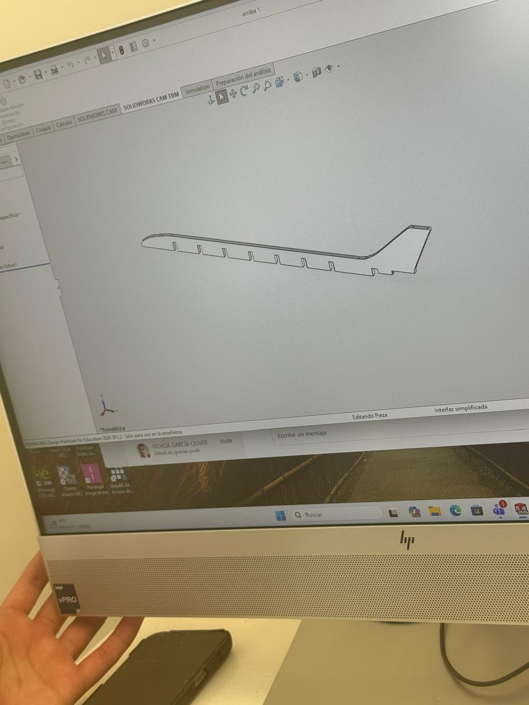
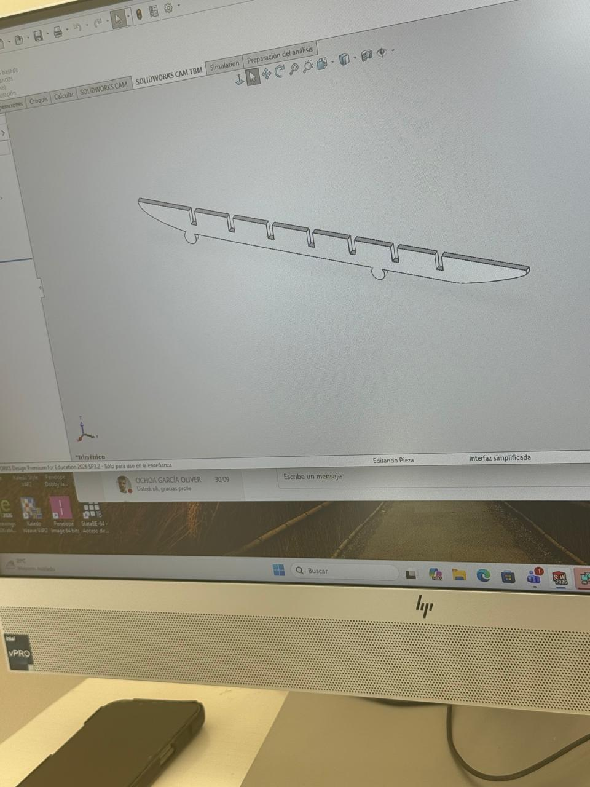
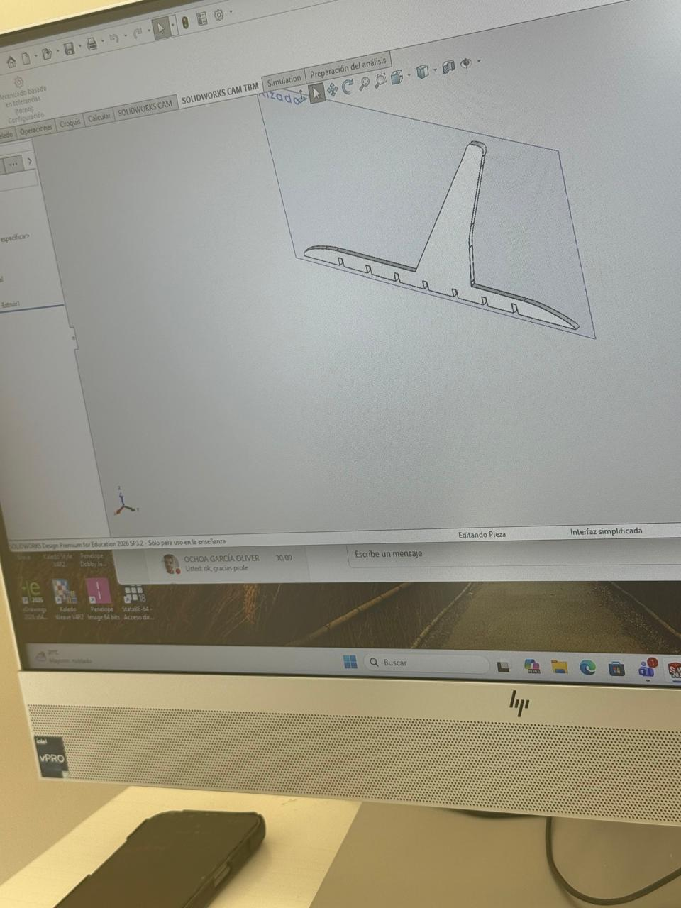
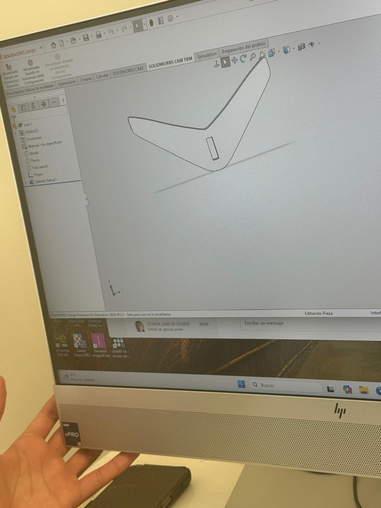
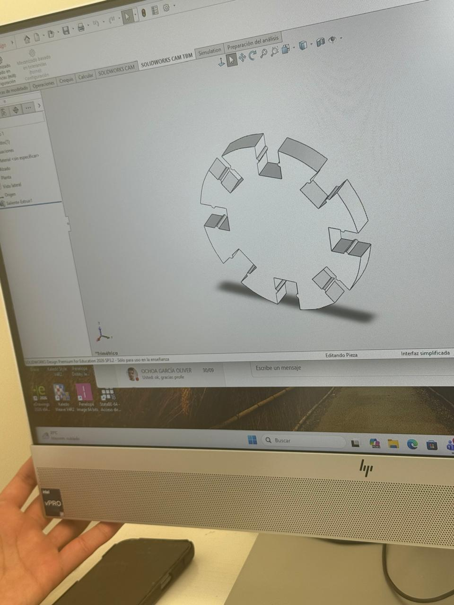

## Práctica 2: Práctica de corte en láser 

Posterior a la clase previa sobre corte láser impartida por el profesor Oliver, se nos asignó como práctica realizar un ensamblaje en **SolidWorks** y cortarlo en **MDF** para posteriormente ensamblarlo en físico.

### Proceso de trabajo:

1. **Diseño individual:** Comenzamos diseñando nuestro ensamble pieza por pieza.
{loading=lazy}
{loading=lazy}
{loading=lazy}
{loading=lazy}
{loading=lazy}

2. **Verificación de ensamble:** Probamos que las piezas embonaran de manera correcta dentro de SolidWorks.
  {loading=lazy}

3. **Anidado (Layout):** Planeamos la disposición y posicionamiento de las piezas sobre la placa de MDF dentro del mismo programa.
  {loading=lazy}

4. **Exportación:** Exportamos el documento en formato `.dxf` para poder procesarlo en el software de la cortadora láser.

5. **Ensamble final:** Cortamos y ensamblamos el producto en la vida real.
{loading=lazy}

> **Nota:** Se tomaron en cuenta las consideraciones del **Kerf** (ancho de corte del láser) y las dimensiones exactas del MDF, tal como nos indicó el profesor Oliver en la clase teórica.