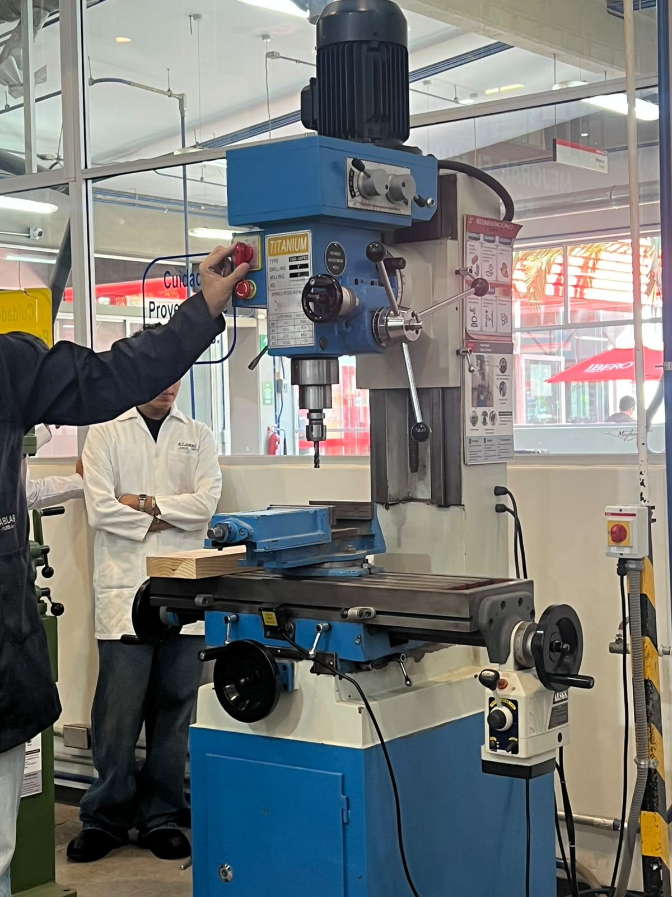
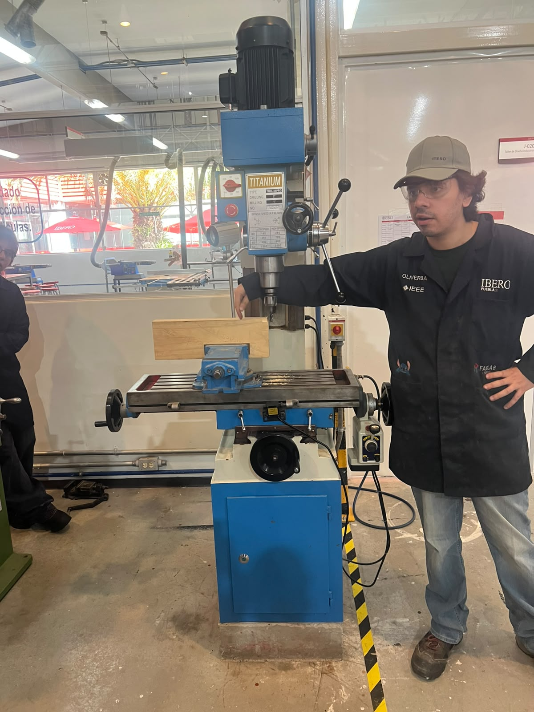
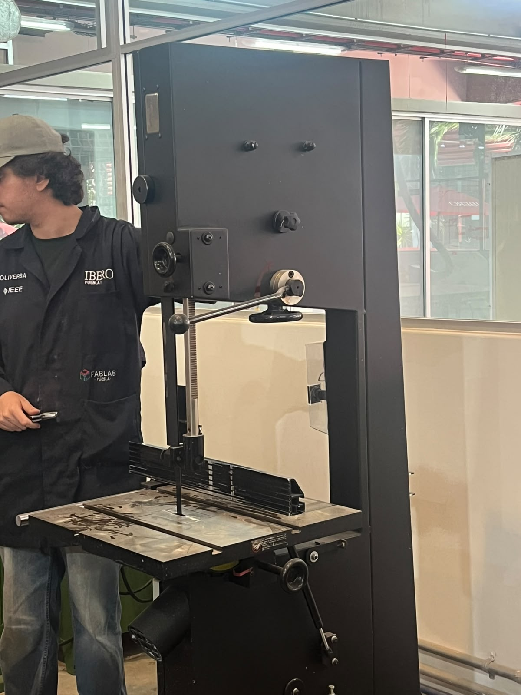
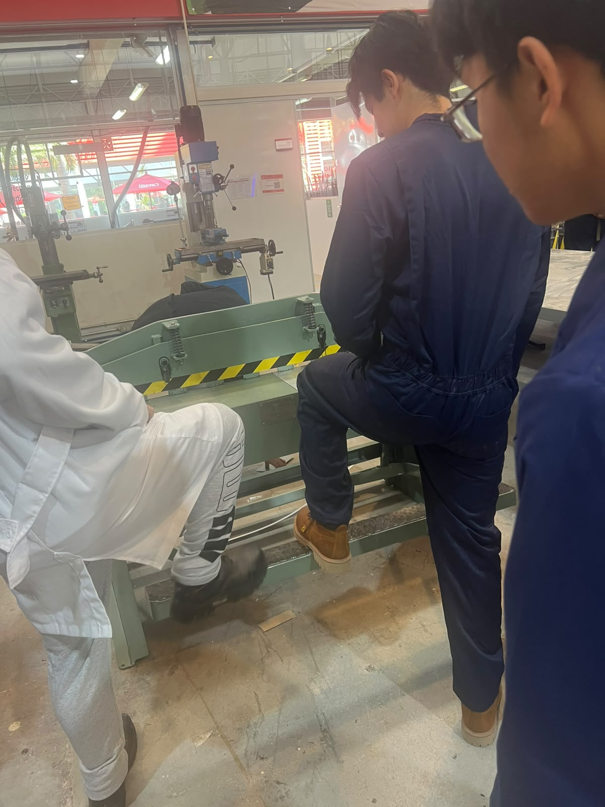
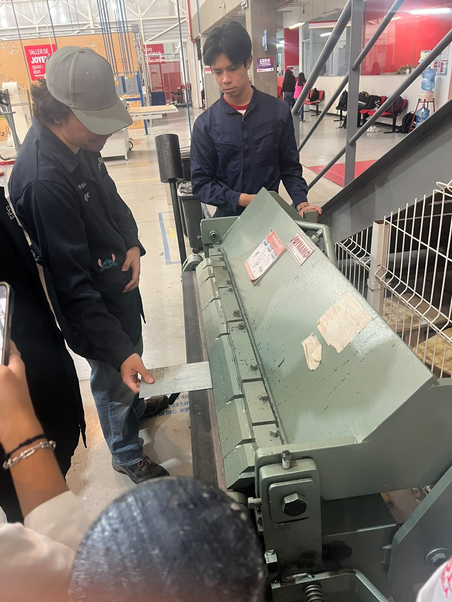
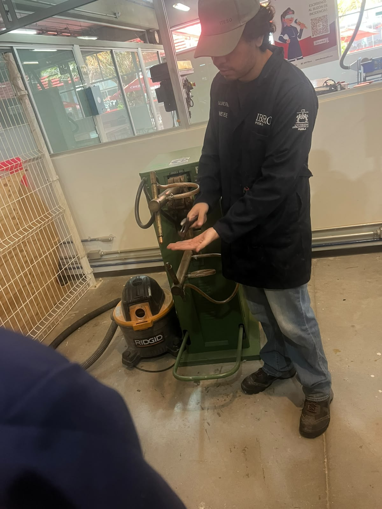
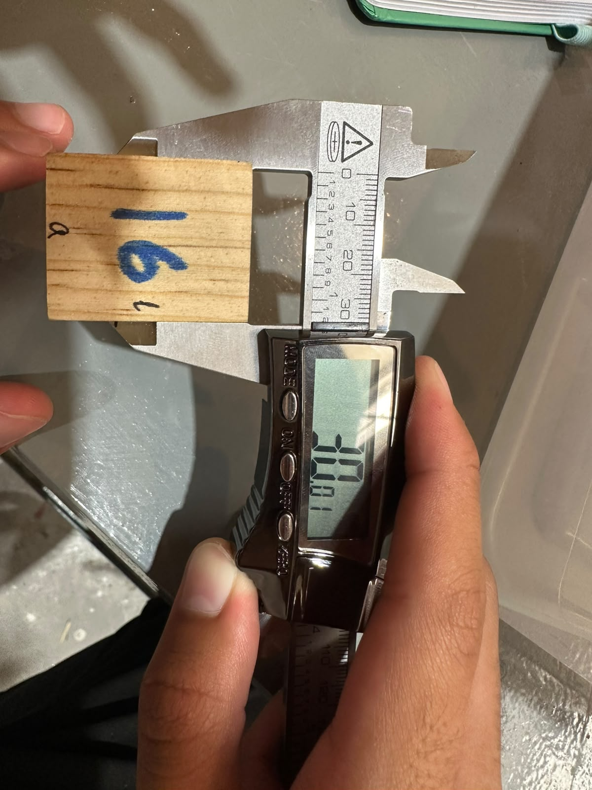
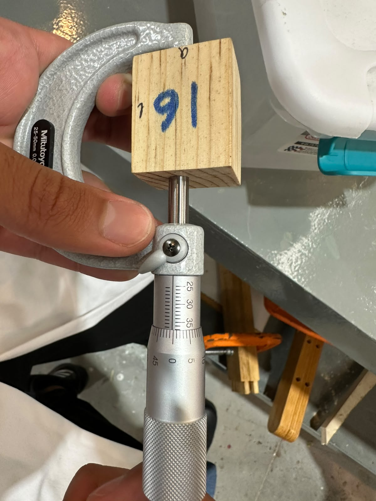

## Práctica 3: Medición y Maquinaria 

Iniciamos la clase en la explanada del **IDIT**, donde el profesor Oliver nos presentó diversas máquinas manuales y explicó su funcionamiento:

* **Fresa:** Utilizada para realizar cortes laterales; su geometría es similar a la de una broca.

{loading=lazy}
{loading=lazy}
* **Sierra cinta:** Diseñada para realizar cortes continuos en madera, tanto rectos como curvos.
{loading=lazy}
* **Guillotina para metales manual:** Sirve para cortar láminas de metal aprovechando el propio peso y palanca del operador.
{loading=lazy}
* **Dobladora de láminas:** Máquina empleada para dar ángulos y pliegues a láminas metálicas.
{loading=lazy}
* **Soldadora por puntos:** Utilizada para la unión puntual de láminas metálicas mediante resistencia eléctrica.
{loading=lazy}

---

### Instrumental de Medición
Asimismo, realizamos la medición de cubos utilizando dos herramientas de precisión:

1. **Vernier (Calibrador pie de rey):** Permite medir dimensiones exteriores, interiores y profundidades (con la varilla inferior).
{loading=lazy}
2. **Micrómetro:** Permite medir dimensiones muy pequeñas con altísima precisión.
{loading=lazy}

| Cubo | A | L | H |
| :---: | :---: | :---: | :---: |
| 5 | 25.89mm | 28.09mm | 23.35mm |
| 15 | 46.96mm | 50.17mm | 23.23mm |
| 17 | 32.21 | 41.34 | 29.89mm |
| 6 | 32.34mm | 43.45 | 28.55mm |
| 16 | 30.01mm | 37mm | 25.34mm |

*Las medidas de los cubos concidieron medidos con ambos instrumentos*