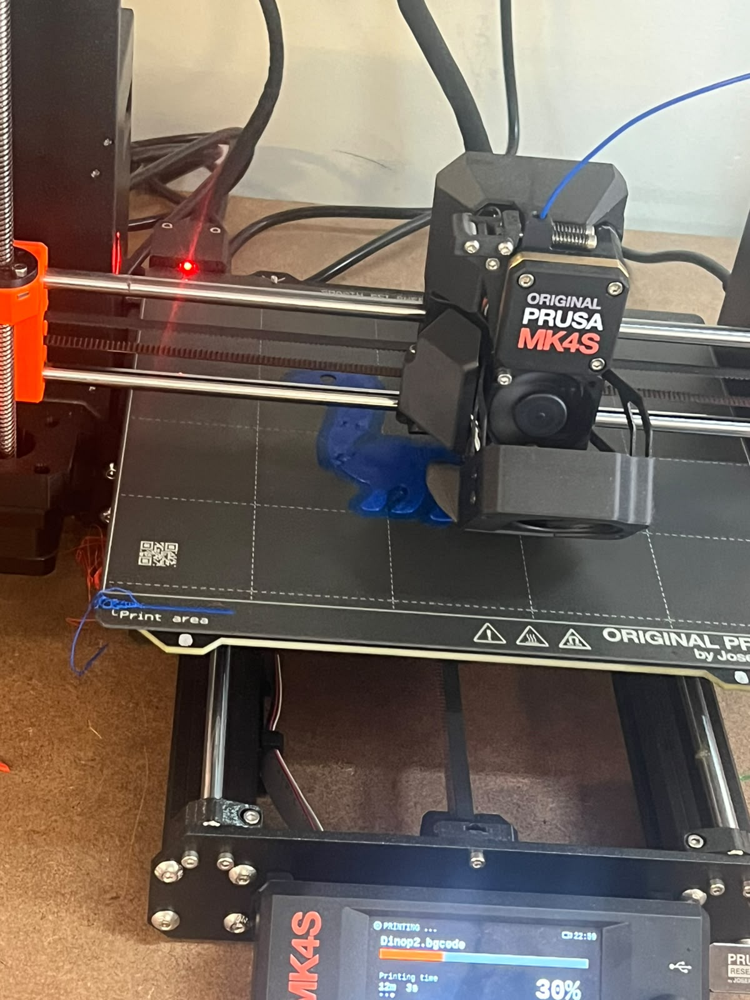
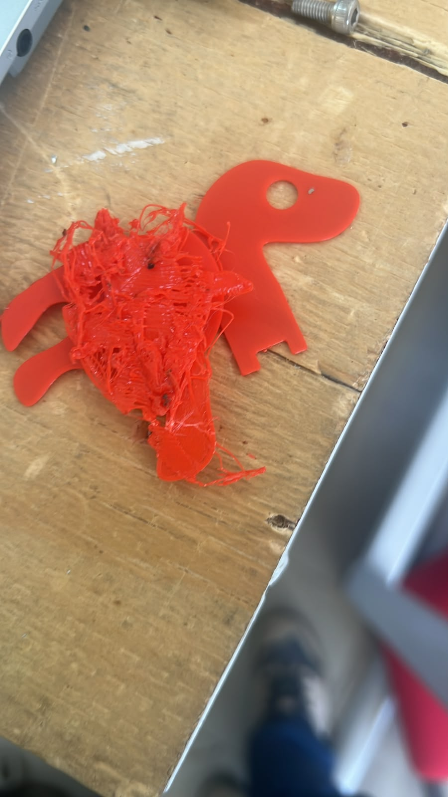
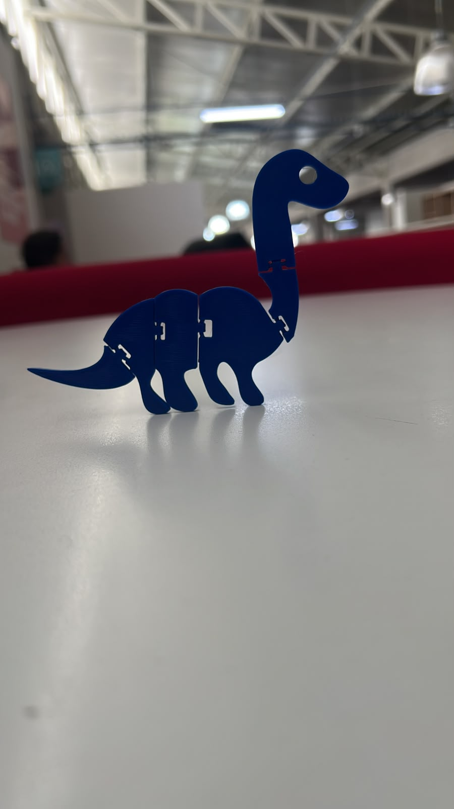
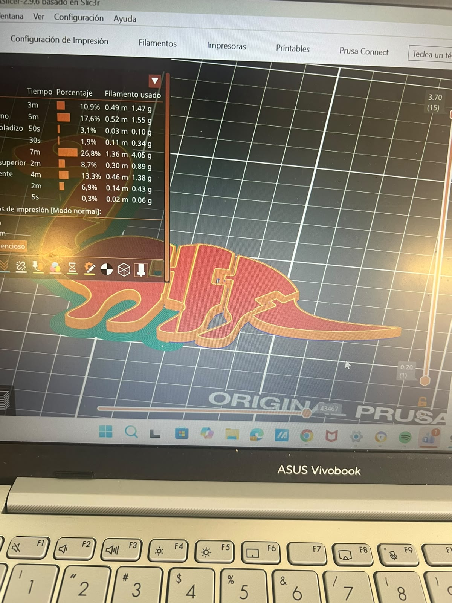

## Práctica 4: Dinosaurio 🦕

A partir de los conceptos aprendidos sobre impresión 3D, se nos asignó diseñar una pieza con mecanismos de movimiento articulados que **no fuera un ensamblaje**; es decir, debía imprimirse en una sola sesión (*Print-in-place*) y mantener movilidad al finalizar.

### Proceso y Desafíos:
* Personalmente, elegí diseñar un **dinosaurio** con articulaciones funcionales en sus extremidades, cola y cuello.
* Diseñé cada parte por separado, las extruí a la distancia calculada y las articulé dentro del modelo general para su impresión en una sola pieza.
{loading=lazy}

* **Complicaciones:** Al momento de imprimir, algunas piezas presentaban una ligera inclinación, lo que provocó que la impresión fallara en dos ocasiones.
{loading=lazy}
{loading=lazy}
* **Resultado:** En el tercer intento se corrigió la orientación y se logró imprimir con éxito.
{loading=lazy}
{loading=lazy}
* **Configuración:** Se utilizó un **5% de relleno (infill)** para la pieza.

*archivos*
[LB2](../recursos//archivos/colita%201.SLDPRT){loading=lazy}
[LB2](../recursos//archivos/cuello%201.SLDPRT){loading=lazy}
[LB2](../recursos//archivos/Cuerpo1%201.SLDPRT){loading=lazy}
[LB2](../recursos//archivos/Cuerpo2%201.SLDPRT){loading=lazy}
[LB2](../recursos//archivos/cuerpo3%201.SLDPRT){loading=lazy}
[LB2](../recursos//archivos/Final%20final%20jp.SLDASM){loading=lazy}
[LB2](../recursos//archivos/cabezita%201%201.SLDPRT){loading=lazy}