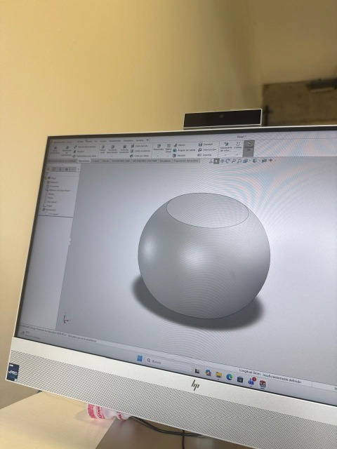
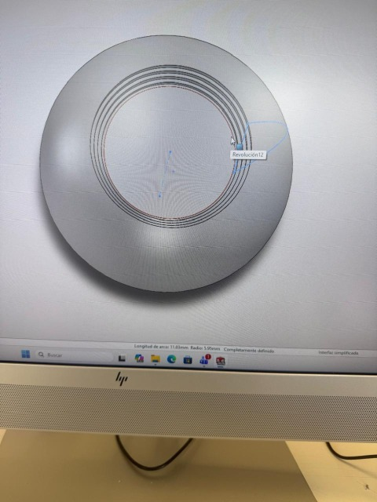

Institución: Universidad Iberoamericana Puebla (Ibero Puebla)  
Materia: Proyecto de Ingeniería  
Alumno: Carlos Mario Díaz Moscoso  
Profesor: Oliver Ochoa García  

# Práctica 1: Modelado de Mecanismo Concéntrico Articulado en SolidWorks
**Fecha:** 18 de septiembre de 2026

---

## 1. Introducción y Objetivo de la Clase
En esta sesión con el maestro Oliver, nos enfocamos en aprender los conceptos clave de diseño para prepararnos en la creación de piezas articuladas y con movimiento en SolidWorks. El objetivo principal fue entender cómo estructurar un mecanismo tipo *Print-in-Place* a nivel digital, logrando que una sola pieza contenga partes móviles independientes diseñadas directamente desde el croquis.

---

## 2. Guía de Materiales, Ventajas y Desventajas
Durante la clase revisamos los filamentos de uso frecuente en impresión 3D FDM, comprendiendo sus propiedades térmicas, ventajas y desventajas al momento de seleccionar el material adecuado para un proyecto:

| Material | Temp. Boquilla | Temp. Cama | Ventajas Principales / Desventajas |
| :--- | :--- | :--- | :--- |
| **PLA** | $190^\circ\text{C} - 220^\circ\text{C}$ | $50^\circ\text{C} - 60^\circ\text{C}$ | Fácil de imprimir, económico, biodegradable, sin warping.   - Baja resistencia térmica ($> 60^\circ\text{C}$), frágil. |
| **ABS** | $230^\circ\text{C} - 250^\circ\text{C}$ | $80^\circ\text{C} - 110^\circ\text{C}$ | Alta resistencia al impacto, buena estabilidad térmica, fácil de pulir.   - Warp severo, vapores nocivos, requiere cabina cerrada. |
| **PETG** | $230^\circ\text{C} - 250^\circ\text{C}$ | $70^\circ\text{C} - 80^\circ\text{C}$ | Excelente adherencia, resistente a químicos e impactos, sin cabina.   - Tiende a dejar hilos (stringing) y se raya fácilmente. |
| **Nylon (PA)** | $240^\circ\text{C} - 260^\circ\text{C}$ | $70^\circ\text{C} - 100^\circ\text{C}$ | Extremadamente duradero, flexible bajo alta tensión, bajo coeficiente de fricción.   - Higroscópico (absorbe humedad), complejo de adherir. |
| **TPU** | $210^\circ\text{C} - 230^\circ\text{C}$ | $20^\circ\text{C} - 60^\circ\text{C}$ | Gran elasticidad, alta resistencia al desgaste, amortiguación.   - Velocidad lenta, requiere extrusor directo. |

---

## 3. Puntos Clave de Diseño para Piezas Articuladas
* **Tolerancias de separación:** Se debe dejar un espacio libre adecuado entre las piezas móviles adyacentes para asegurar el juego mecánico y evitar fusiones indeseadas.
* **Ángulo de voladizo:** Las superficies con inclinaciones pronunciadas requieren consideraciones geométricas en los perfiles para que puedan fabricarse adecuadamente.
* **Orientación geométrica:** Planear la disposición de los elementos considerando cómo se comportarán las uniones y las tensiones estructurales.
* **Estrategia de relleno (Infill):** Uso de porcentajes moderados y patrones adecuados según las necesidades del modelo.

---

## 4. Ejercicio Práctico en SolidWorks
Como práctica principal, modelamos una pieza concéntrica articulada (tipo 'cebolla') aplicando los siguientes pasos:
* **Uso de la Herramienta Revolución:** En SolidWorks elaboramos el croquis con el perfil de los anillos —empleando formas esféricas cóncavas y convexas— y aplicamos la operación de Saliente/Base Revolucionado para generar la geometría tridimensional concéntrica.
* **Holgura específica de $0.25\text{ mm}$:** En el croquis se estableció una separación exacta de $0.25\text{ mm}$ entre cada anillo vecino para asegurar el espacio libre necesario entre las partes móviles.
* **Geometría de topes:** Las curvas diseñadas mediante la revolución actúan como topes mecánicos que impiden que los anillos se salgan verticalmente de su posición, permitiendo únicamente su movimiento deslizante entre ellos.

---

## 5. Evidencia Visual del Proyecto
{loading=lazy}
{loading=lazy}

---

## 6. Conclusión
En lo personal, esta práctica me sirvió muchísimo para entender cómo planear y diseñar piezas articuladas desde cero en SolidWorks. Comprender la importancia de dejar la tolerancia exacta —como los $0.25\text{ mm}$ en los anillos concéntricos— y usar herramientas como la revolución me hizo ver lo crucial que es anticiparse a la impresión 3D. Al final, es un proceso de ir afinando detalles para que las partes realmente se muevan sin fundirse, lo cual hace que todo cobre sentido al momento de fabricarlo.

