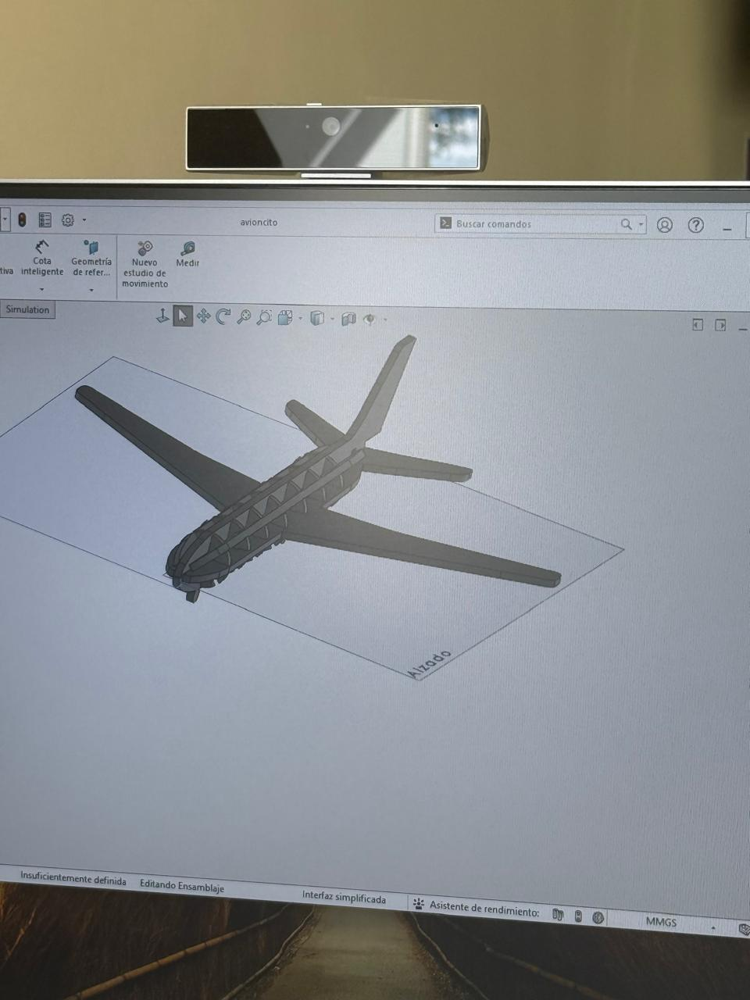
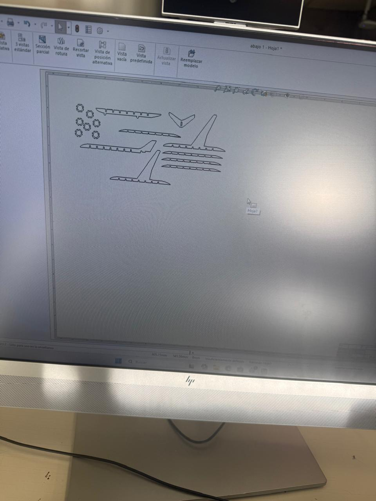
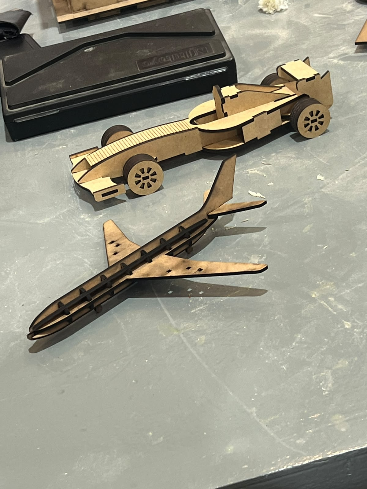

# Práctica 2: Ensambles en SolidWorks y Corte Láser (Avión a Escala en MDF)
**Fecha:** 24 de septiembre de 2026

---

## 1. Introducción y Fundamentos Técnicos
En esta sesión trabajamos la integración entre el diseño paramétrico en SolidWorks y la manufactura digital mediante corte láser CNC. Al diseñar piezas que se construyen a partir de láminas planas ensambladas por presión (press-fit), es fundamental considerar los parámetros físicos del proceso desde la etapa inicial del dibujo:
- **Kerf (Ancho de sangría):** Representa el espesor de material que el haz láser vaporiza o remueve al seguir la trayectoria de corte. Si no se contempla este margen en las cotas, las ranuras quedan más anchas de lo planificado y los dientes de ensamble más delgados, provocando que la estructura quede floja.
- **Tolerancias dimensionales en MDF:** El material base utilizado para el prototipo fue MDF. Dado que las láminas de este material presentan ligeras variaciones de espesor, fue necesario calcular y aplicar tolerancias especializadas en las uniones para lograr que cada pieza embonara a presión de forma firme.

---

## 2. Clasificación de Materiales en Corte Láser
- **Materiales Permitidos:** MDF, madera triplay, papel, cartón, acrílico, fieltro, telas sintéticas/algodón y cuero natural.
- **Materiales Estrictamente Prohibidos:** PVC, vinil y cuerina artificial (liberan gas cloro altamente corrosivo y tóxico), Policarbonato/Lexan (se quema, absorbe mal la luz y genera demasiado humo), ABS (libera vapores de cianuro), HDPE y espuma de poliestireno/unicel (riesgo extremo de incendio e inflamación rápida).

---

## 3. Desarrollo del Proyecto: Avión Escala en MDF

### 3.1. Proceso de Adaptación y Rediseño
Para el desarrollo de mi entregable individual elegí fabricar un modelo de avión. El proceso comenzó tomando como base una plantilla que fui calcando para generar el perfil de las piezas. Sin embargo, el diseño original resultaba ser bastante complejo y no contaba aún con los conocimientos necesarios para llevar a cabo ciertos grabados o partes muy elaboradas que incluía. Por esta razón, tomé la decisión de modificar bastante el diseño original, simplificando la pieza y enfocándome en ajustar los puntos clave de ensamble para que fuera completamente funcional en MDF.

### 3.2. Preparación de Archivos (.DXF) y Anidado (Nesting)
Una vez definidas las formas y estructuras de las piezas:
- **Paso 1:** Se generaron las vistas planas a escala real $1:1$ dentro del módulo de dibujo de SolidWorks.
- **Paso 2:** Cada pieza se pasó a un archivo plano en formato `.DXF` (Drawing Exchange Format) para poder enviarlas al software del láser.
- **Paso 3:** Dentro del programa de control de la máquina se realizó el anidado (*nesting*), acomodando y distribuyendo todas las piezas para ahorrar el mayor espacio posible dentro de la lámina de MDF y reducir el desperdicio.

### 3.3. Manufactura y Proceso de Corte Láser
El proceso de corte contó en un inicio con la guía y supervisión directa del profesor Oliver, quien nos ayudó al momento de imprimir con láser nuestras piezas. Sin embargo, debido a que tuve algunos problemas con las tolerancias al intentar armarlo la primera vez, tuve que ir personally después al área de corte láser para hacer los ajustes necesarios e imprimir las piezas por mi cuenta. Gracias a que ya había observado atentamente cómo el maestro seguía todos los pasos para un buen corte y a que había practicado previamente, pude operar el equipo solo y lograr que la impresión saliera de manera correcta.

---

## 4. Galería del Prototipo Final

---

## 5. Conclusión
Esta práctica fue un trabajo bastante retador por mi parte y la verdad le puse mucho esfuerzo para que saliera bien. Adaptar un diseño complejo a mis conocimientos actuales, corregir los problemas de tolerancia específicos para el MDF y exportar los planos a formato `.DXF` me dejó un gran aprendizaje. Además, haber solucionado los detalles por mi cuenta e ir a cortar las piezas de forma independiente me dio mucha confianza para usar la cortadora láser en proyectos futuros.