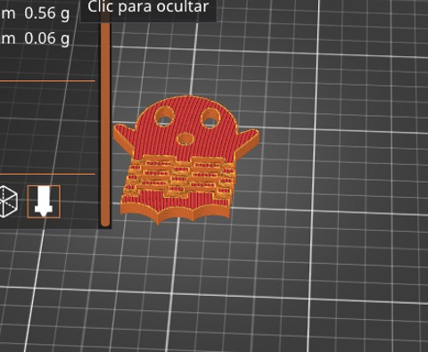
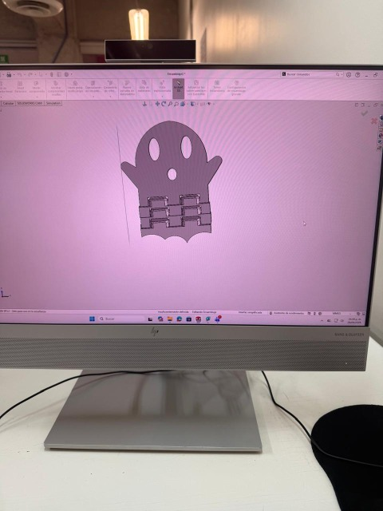
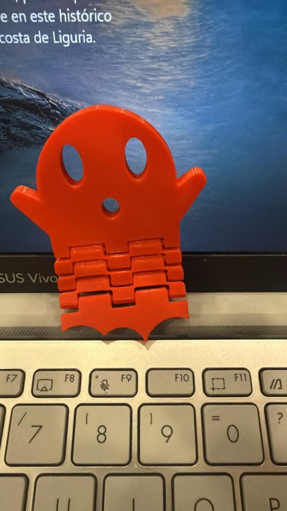

# Práctica 4: Diseño y Manufactura de Fantasma Articulado 'Print-in-Place' en SolidWorks
**Institución:** Universidad Iberoamericana Puebla (Ibero Puebla)    
**Materia:** Proyecto de Ingeniería    
**Alumno:** Carlos Mario Díaz Moscoso    
**Profesor:** Oliver Ochoa García    
**Fecha:** 2 de octubre de 2026  

---

## 1. Introducción y Contexto  
En esta práctica de diseño CAD se desarrolló un modelo tridimensional articulado con temática de fantasma  . El diseño surgió como una idea propia y fue modelado directamente en SolidWorks  . El enfoque principal consistió en aplicar la técnica de fabricación *Print-in-Place* (impresión en una sola pieza articulada), logrando que las uniones mecánicas funcionaran sin necesidad de ensamblaje posterior  .

---

## 2. Consideraciones de Diseño y Herramientas CAD  
Para lograr que la pieza fuera completamente articulada y evitar que las capas de filamento se fusionaran durante la impresión FDM, se diseñaron uniones de tipo eje con una holgura o tolerancia de aproximadamente $0.45\text{ mm}$ entre los componentes móviles  . Esta separación milimétrica fue clave para garantizar el movimiento fluido de los eslabones tras el enfriamiento del material  .

Durante el proceso en SolidWorks, se aplicaron diversas herramientas fundamentales de modelado paramétrico  :
* **Extrusión de base y corte:** Utilizadas para dar volumen al cuerpo y vaciar con precisión las cavidades de los ojos, la boca y los alojamientos de las articulaciones  .
* **Redondeos (Fillets):** Aplicados estratégicamente para suavizar aristas, reducir concentraciones de esfuerzos y permitir el juego mecánico libre entre los ejes  .
* **Ensamblajes:** Esenciales para verificar la cinemática, el rango de movimiento y el correcto acoplamiento de las piezas antes de exportar el archivo definitivo a formato STL  .

---

## 3. Desglose de las Partes del Modelo  
El diseño geométrico se divide estructuralmente en tres componentes principales  :
1. **La Cabeza:** La sección superior del fantasma que integra los rasgos faciales (ojos y boca mediante extrusiones de corte) y los brazos fijos  .
2. **Los Eslabones:** Segmentos intermedios móviles que conectan la parte superior con la inferior, diseñados con pasadores y cavidades cilíndricas para dar flexibilidad y movimiento dinámico  .
3. **La Cola:** El segmento final de la estructura que cierra la cadena cinemática del cuerpo flexible  .

---

## 4. Proceso de Manufactura y Uso de PrusaSlicer  
Una vez finalizado el diseño en CAD, la preparación del código G se realizó mediante el laminador PrusaSlicer, lo que permitió dominar las herramientas básicas del software  :
* **Configuración de materiales:** Selección adecuada del tipo de filamento y parámetros térmicos  .
* **Corte y orientación:** Dominio de las herramientas de posición para acomodar la pieza de manera óptima sobre la cama de impresión  .
* **Soportes:** Gracias a la geometría optimizada y las tolerancias del diseño en SolidWorks, esta pieza no requirió soportes  . Este dominio del software permitió además orientar y apoyar a compañeros de clase en la configuración de soportes y parámetros para sus propios proyectos  .

---

## 5. Conclusión  
En lo personal, esta práctica me sirvió muchísimo para soltarme más con SolidWorks y entender cómo llevar una idea propia hasta la impresora 3D  . Me di cuenta de lo clave que es calcular bien las tolerancias desde el croquis —como los $0.45\text{ mm}$ que le dejé a los ejes— para que las partes no se peguen y el fantasma quede bien articulado  . Además, aprender a moverle a PrusaSlicer estuvo muy padre porque no solo me ayudó a sacar mi pieza sin necesitar soportes, sino que también pude echarle la mano a mis compañeros para configurar sus impresiones  .

[Pieza1](../recursos//archivos/PIEZA1%20(1).SLDPRT){loading=lazy}
[Pieza2](../recursos//archivos/PIEZA22%201.SLDPRT){loading=lazy}
[Pieza3](../recursos//archivos/PIEZA3%201.SLDPRT){loading=lazy}
[Ensamblaje solid](../recursos//archivos/Ensamblajefinalf%201.SLDASM){loading=lazy}
[Ensamble](../recursos//archivos/Ensamblajefinalf.STL){loading=lazy}