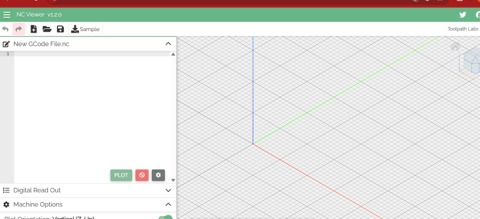
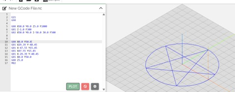
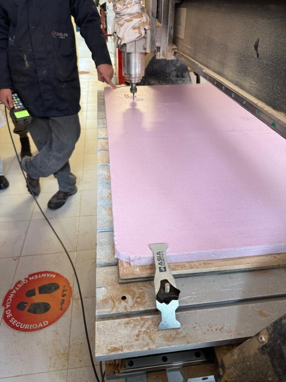
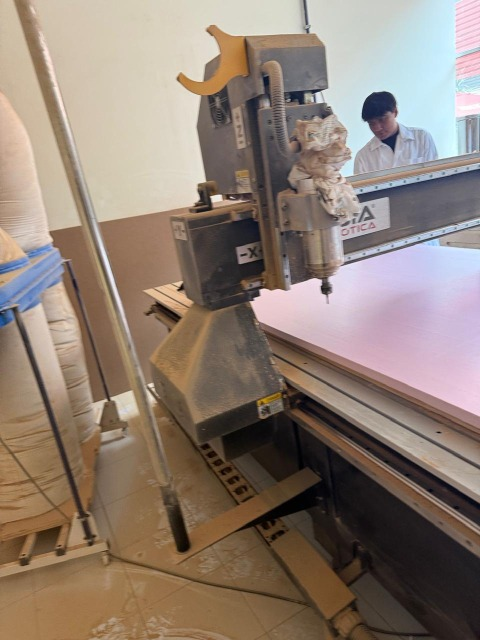
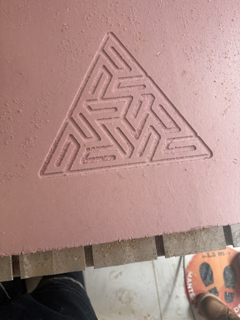

# Práctica 5: Introducción al Maquinado CNC, Simulación en NC Viewer y Router Asia Robótica
**Institución:** Universidad Iberoamericana Puebla (Ibero Puebla)  
**Materia:** Proyecto de Ingeniería  
**Alumno:** Carlos Mario Díaz Moscoso  
**Profesor:** Oliver Ochoa García  
**Ubicación:** Fab Lab Puebla  
**Fecha:** 9 de octubre de 2026
## 1. Introducción y el Papel del NC Viewer en el Proceso CAM
Antes de operar una máquina de control numérico computarizado (CNC) física, es indispensable contar con herramientas de validación digital que nos permitan prevenir errores graves de colisión, rotura de fresas o fallas en el material. Aquí es donde entra NC Viewer (ncviewer.com), una plataforma de simulación basada en navegador web que cumple un rol fundamental en la etapa previa al maquinado real.
El propósito principal de utilizar NC Viewer es visualizar de manera gráfica y tridimensional las trayectorias que seguirá la herramienta de corte a partir del código G generado. Nos sirve como un filtro de seguridad y aprendizaje para:
* **Validación de cotas:** Comprobar que las coordenadas programadas correspondan exactamente al diseño deseado sin saltos extraños.
* **Prevención de colisiones:** Identificar si existen movimientos erróneos en los ejes o profundidades de corte excesivas (Z) antes de enviarlas al controlador de la máquina real.
* **Traducción cinemática:** Entender la lógica matemática detrás de los comandos numéricos y cómo el software traduce los vectores en instrucciones físicas para los motores.

 
---
## 2. Programación y Control en G-Code
### 2.1. Sintaxis y Diccionario Ampliado de Comandos G y M
El código G y el código M son los lenguajes estandarizados utilizados para indicarle al control numérico de la máquina las trayectorias geométricas, las velocidades, el sentido de giro y las funciones auxiliares de operación:
| Comando / Var. | Descripción / Función | Clasificación |
| :--- | :--- | :--- |
| G0 / G00 | Movimiento rápido de posicionamiento (sin realizar corte). | Movimiento |
| G1 / G01 | Movimiento lineal controlado con avance de corte definido por F. | Interpolación |
| G2 / G02 | Interpolación circular en sentido horario (CW - Clockwise). | Interpolación |
| G3 / G03 | Interpolación circular en sentido antihorario (CCW). | Interpolación |
| G04 | Temporización o pausa (Dwell) mediante parámetro P o X. | Control Temporal |
| G17 | Selecciona el plano de trabajo XY. | Selección de Plano |
| G18 | Selecciona el plano de trabajo XZ. | Selección de Plano |
| G19 | Selecciona el plano de trabajo YZ. | Selección de Plano |
| G20 | Define el sistema de unidades en pulgadas. | Unidades |
| G21 | Define el sistema de unidades en milímetros. | Unidades |
| G28 | Retorno automático al punto de referencia de la máquina (Home). | Referencia |
| G40 | Cancela la compensación de radio de la herramienta. | Compensación |
| G41 | Activa la compensación de radio a la izquierda del contorno. | Compensación |
| G42 | Activa la compensación de radio a la derecha del contorno. | Compensación |
| G43 | Activa la compensación de longitud de la herramienta. | Compensación |
| G53 | Utiliza el sistema de coordenadas de la máquina (MCS). | Sistema Coord. |
| G54 a G59 | Selecciona Sistemas de Coordenadas de Trabajo (WCS). | Sistema Coord. |
| G80 | Cancela los ciclos fijos (perforación, cajeado, roscado). | Ciclos Fijos |
| G81 | Ciclo fijo de taladrado simple. | Ciclos Fijos |
| G83 | Ciclo fijo de taladrado con descargas profundas (Peck Drilling). | Ciclos Fijos |
| G90 | Programación en Coordenadas Absolutas. | Modo Coord. |
| G91 | Programación en Coordenadas Incrementales. | Modo Coord. |
| G92 | Establece temporalmente el sistema de coordenadas actual. | Modo Coord. |
| X, Y, Z | Coordenadas espaciales de posición en los ejes tridimensionales. | Posición |
| I, J, K | Distancias incrementales al centro de un arco en ejes X, Y, Z. | Parám. Arco |
| F | Velocidad de avance (Feed Rate, p. ej., F180 o F300). | Parám. Corte |
| S | Velocidad del husillo (Spindle Speed en RPM, p. ej., S18000). | Parám. Corte |
| T | Selección de número de herramienta (Tool). | Parám. Herram. |
| M3 / M03 | Encender el husillo en sentido horario (CW). | Función Aux. (M) |
| M5 / M05 | Apagar el husillo (Spindle Stop). | Función Aux. (M) |
| M30 | Fin del programa, reinicio de ciclos y rebobinado. | Función Aux. (M) |
### 2.2. Simulación y Validación en NC Viewer (Ejercicio del Pentagrama)
Como parte del aprendizaje práctico en clase con el maestro Oliver, pusimos a prueba la lógica de coordenadas y la estructura del código G realizando la simulación de un pentagrama en la plataforma NC Viewer. Interpretamos y verificamos líneas de código como los posicionamientos rápidos (G00), los avances lineales de corte (G01) y las interpolaciones circulares (G02), observando de qué manera la herramienta ejecuta la geometría en el plano 2D/3D antes de pasar al equipo real:






```gcode
G21
G90
G00 X50.0 Y0.0 Z5.0 F1000
G01 Z-1.0 F300
G02 X50.0 Y0.0 I-50.0 J0.0 F500
G00 X0.0 Y50.0
G01 X29.39 Y-40.45
G01 X-47.55 Y15.45
G01 X47.55 Y15.45
G01 X-29.39 Y-40.45
G01 X0.0 Y50.0
G00 Z5.0
M02
```
---
## 3. Preparación CAM en VCarve Pro y Transferencia vía USB
Debido a limitaciones de tiempo en la sesión para elaborar un modelo complejo desde cero, el maestro Oliver tomó la decisión de que utilizáramos una plantilla obtenida de internet.
Para procesar este diseño vectorial y prepararlo para la máquina, el procedimiento fue el siguiente:
* **Importación a VCarve Pro:** Abrimos la plantilla en el software VCarve Pro (software CAD/CAM utilizado en el taller).
* **Configuración de Material y Trayectorias:** En VCarve Pro se definieron las dimensiones del bloque de espuma rosa, la selección de la fresa, la velocidad de avance, la velocidad del husillo y la profundidad de corte por pasada.
* **Generación del Código G:** Una vez calculadas las trayectorias (Toolpaths), se exportó el archivo en el postprocesador compatible con el router CNC.
* **Transferencia mediante USB:** El archivo de maquinado generado se guardó en una memoria USB para posteriormente conectarla directamente a la consola o controlador DSP de la máquina Asia Robótica en el área de corte.
---
## 4. Descripción y Operación del Router CNC Asia Robótica (Shop-1325)
Para el maquinado físico en la Ibero Puebla utilizamos el Router CNC Asia Robótica Shop-1325 ubicado en el Fab Lab. Esta máquina es un equipo de gran formato diseñado para el fresado y corte de tableros, acrílicos y polímeros. Funciona mediante motores de alta precisión que desplazan el cabezal sobre los ejes cartesianos mientras el husillo gira a altas revoluciones.
La espuma rosa fue el material seleccionado debido a sus cualidades de baja densidad, facilidad para el arranque de viruta y gran estabilidad dimensional, permitiendo validar geometrías de forma rápida y segura.
---
## 5. Protocolo de Preparación y Maquinado de la Espuma Rosa
Para garantizar un maquinado preciso y seguro en la máquina Asia Robótica, se siguieron los siguientes pasos operativos:
1. **Limpieza de la base y la cama de sacrificio:** Se limpió la superficie del tablero de sacrificio para retirar cualquier residuo, viruta o polvo acumulado. Mantener plana esta base es indispensable para evitar irregularidades en el eje Z.
2. **Fijación del material:** Se colocó el bloque de espuma rosa sobre la cama y se aseguró firmemente mediante prensas/bridas para evitar que se desplace o vibre con la fuerza del corte.
3. **Conexión de la memoria USB y carga del archivo:** Se insertó la memoria USB con el archivo generado previamente en VCarve Pro en el controlador de la máquina.
4. **Calibración de Ceros (WCS):** Con la consola manual se posicionó la fresa sobre la esquina del material para establecer el origen de trabajo (X0, Y0, Z0).
5. **Ejecución y Supervisión:** Se puso en marcha el ciclo de maquinado bajo supervisión constante, manteniendo activado el sistema de extracción de polvo y teniendo a la mano el botón de paro de emergencia (E-stop).
---
## 6. Conclusión
La práctica en el Fab Lab Puebla ofreció una visión integral del proceso de manufactura asistida por computadora. La simulación inicial en NC Viewer permitió dominar la sintaxis del código G y la lógica espacial de las coordenadas. Por otro lado, la transición a VCarve Pro para procesar una plantilla de internet, exportarla a una memoria USB y ejecutar el corte en la máquina Asia Robótica sobre espuma rosa, reforzó la importancia de la limpieza de base, la fijación correcta del material y la calibración precisa en el mundo real