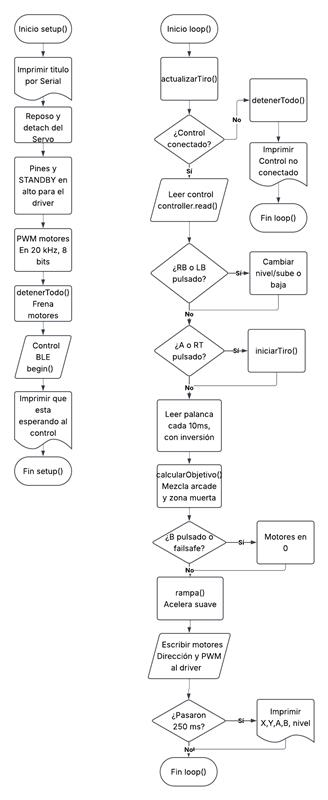

# Proyecto 1: Carro por Bluetooth

**Institución:** Universidad Iberoamericana Puebla  
**Materia:** Introducción a la Mecatrónica  
**Integrantes:**  
* Daniel Alejandro Trejo Macías  
* Carlos Mario Díaz Moscoso  
* Johan Mauricio Cerqueda Rojas  
* Jose Pablo Sánchez Guerrero  
* Abraham Ramírez García  

## Objetivo
Construir en equipo un carro controlado por Bluetooth, integrando los conocimientos del curso (electrónica, microcontrolador, actuadores, comunicación y mecanismos), el cual será usado en un torneo de fútbol RC.

## Requisitos

### Funcionales
* El carro se mueve adelante, atrás, izquierda, derecha y alto por comandos Bluetooth.
* Control de velocidad por PWM (mínimo 3 niveles o velocidad proporcional).
* El protocolo de comandos está documentado en el portafolio (qué comando hace qué).
* Failsafe: si se pierde el enlace o no llegan comandos en ≤1 s, el carro se detiene solo.
* Interruptor físico de encendido/apagado accesible sin desarmar nada.
* Alimentación de motores separada del ESP32 (con GND común), como se vio en el tema de Actuadores.
* Cableado ordenado y sujeto: nada de cables sueltos arrastrando.
* Superficie plana horizontal de al menos 6 × 6 cm en la parte superior, despejada: ahí vivirá el marcador ArUco del Proyecto Final.

### Propios
* Que sea controlable mediante un control de Xbox.
* Que tenga pinzas rígidas enfrente para maniobrar la pelota.
* Que pueda moverse con dos llantas traseras y una frontal.
* Los cables de los motores deben poder atravesar el chasis para poder conectarlos al puente H.
* Que cuente con carrocería para restringir los contenidos del chasis y así no se salgan.
* Que use un servo en las pinzas para "patear" la pelota.

## Arquitectura

## Plan por semanas
* **Semana 1:** Programación del código inicial, Diseño del chasis, Diseño y programación de la app de prueba para controlar el carro.
* **Semana 2:** Cableado del ESP32, Puente H y Motores, Diseño de la carrocería, Soldado de los cables, Impresión del chasis y de la carrocería, Ajustes al código para manejar por control al carro.

## Criterios de éxito
* Cumplir con todos los requisitos funcionales.
* Que el carro se pueda manejar mediante un control.
* No exceder el límite de área de 20x20 cm.

## Boceto del chasis

## BOM (Lista de Materiales)
| Componente | Precio | Obtención |
|---|---|---|
| Portapilas | $70 | Comprado |
| Power Bank | $350 | Comprado |
| Baterías | $440 | Comprado |
| Servo | $100 | Comprado |
| ESP32 | $180 | Reutilizado |
| Puente H TB6612 | $102 | Prestado |
| Motores TT con caja reductora | $140 | Prestado |
| Llantas de plástico | $49 | Comprado |
| Rueda loca | $20 | Comprado |
| Tornillos y tuercas | $10 | Prestado |
| Power Bank | $350 | Comprado |
| Impresión del Chasis | $16 | Prestado |
| Impresión de la Carrocería | $60 | Prestado |
| Jumpers | $60 | Prestado |
| Mini switch | $20 | Comprado |

## Análisis de riesgos
* **Sobreesfuerzo del servo:** resultando en que deje de funcionar → Reemplazar con otro servo.
* **Se deshaga alguna soldadura:** → Volver a soldar.
* **Descarga de baterías:** → Sustituir por otras baterías mientras las anteriores se recargan.
* **Los motores avancen muy lento:** → Usar un power bank para más alimentación.
* **El carro no se mueve:** → Verificar conexiones.

## Bitácora de fallas
| ¿Qué falló? | ¿Cómo lo encontraron? | ¿Cómo lo resolvieron? |
|---|---|---|
| El servo hacía todos los movimientos que debían ir a los motores | Usamos la app prototipo para controlar el servo y motores | Corregimos unas conexiones sueltas |
| El servo nunca se detenía | Usamos el control de Xbox para controlar el carro una vez que terminamos las conexiones | Ajustamos el código para asegurar que el servo se detuviera |
| El servo dejó de funcionar por sobreesfuerzo | Luego de corregir el código el servo ya se detenía internamente, pero el componente externo todavía no giraba | Conseguimos un servo de reemplazo, pero ya no hubo tiempo para sustituir las conexiones, así que descartamos el uso del servo |
| El carro no se movía | Probamos varias veces a encender el carro para ver si ya funcionaba, pero ninguno de los motores se movía | Verificamos las conexiones y reemplazamos las baterías, además de que volvimos a subir el código |

## Video de funcionamiento
[Haz clic aquí para ver el video](../../recursos/videos/VideoCarroBT.mp4)

## Requisitos vs Resultados
| # | Requisito | ¿Se cumplió? |
|---|---|---|
| 1 | El carro se mueve adelante, atrás, izquierda, derecha y alto por comandos Bluetooth. | Sí |
| 2 | Control de velocidad por PWM (mínimo 3 niveles o velocidad proporcional). | Sí |
| 3 | El protocolo de comandos está documentado en el portafolio (qué comando hace qué). | Sí |
| 4 | Failsafe: si se pierde el enlace o no llegan comandos en ≤1 s, el carro se detiene solo. | Sí |
| 5 | Interruptor físico de encendido/apagado accesible sin desarmar nada. | Sí |
| 6 | Alimentación de motores separada del ESP32 (con GND común), como se vio en el tema de Actuadores | Sí |
| 7 | Cableado ordenado y sujeto: nada de cables sueltos arrastrando | Sí |
| 8 | Superficie plana horizontal de al menos 6 × 6 cm en la parte superior, despejada: ahí vivirá el marcador ArUco del Proyecto Final. | Sí |
| 9 | Que sea controlable mediante un control de Xbox | Sí |
| 10 | Que tenga pinzas rígidas enfrente para maniobrar la pelota | Sí |
| 11 | Que pueda moverse con dos llantas traseras y una frontal | Sí |
| 12 | Los cables de los motores deben poder atravesar el chasis para poder conectarlos al puente H | Sí |
| 13 | Que cuente con carrocería para restringir los contenidos del chasis y así no se salgan | Sí |
| 14 | Que use un servo en las pinzas para "patear" la pelota. | No |

## Lecciones aprendidas
1. **Hacer el trabajo con anticipación:** Hacer avances desde que el proyecto fue encargado nos ayudó a usar el amplio tiempo para corregir errores que se iban presentando.
2. **Checar que las conexiones estén bien:** En muchas ocasiones cuando algo fallaba, al verificar las conexiones nos dábamos cuenta de que una de las conexiones se había separado, y al corregirlo funcionaba después en la mayoría de los casos.
3. **Asegurarse de que el material comprado sea el adecuado:** Cuando estábamos a punto de conectar el portapilas, notamos que era demasiado pequeño para las pilas que usaríamos, así que terminamos gastando dinero de más.

*Nota: Se utilizó IA para generar la estructura del diagrama del código, el esquemático de conexiones y la estructura del README del carro.*